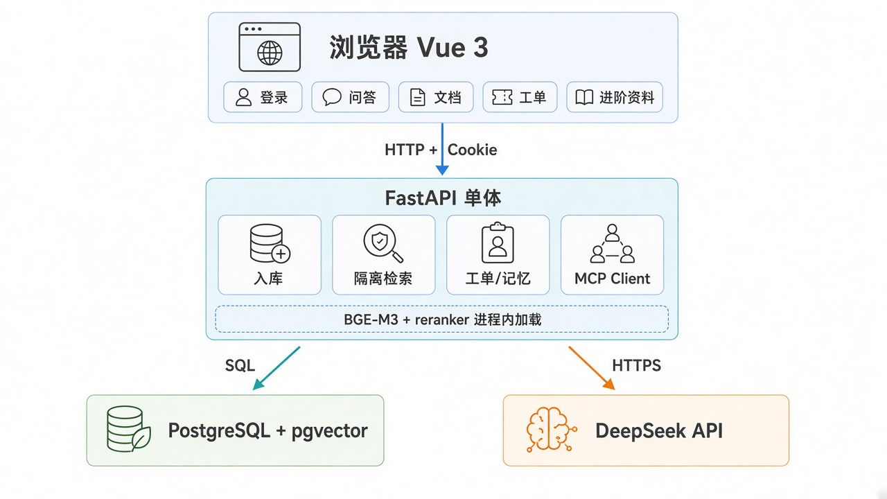
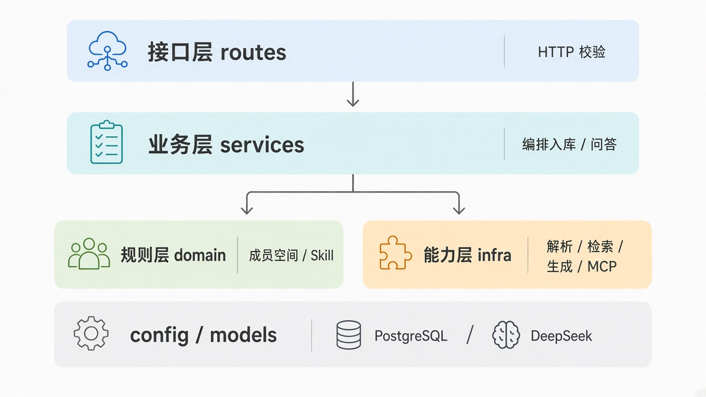
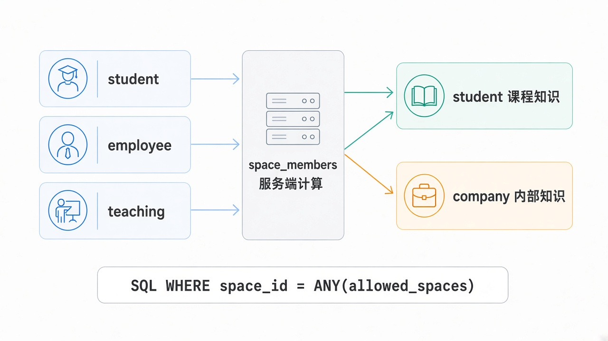
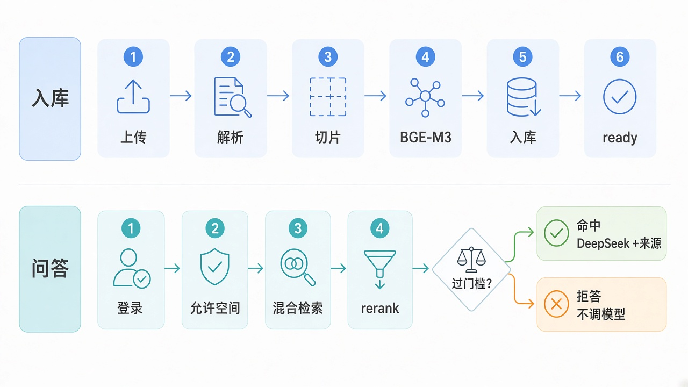

# 统一知识助手系统架构设计

> **权威入口（系统架构）**：模块职责、数据流与接口边界，**讲架构以本文为准**。  
> 课程对照见 [01-课程覆盖.md](./01-课程覆盖.md)；选型见 [04-技术选型.md](./04-技术选型.md)。文档索引见 [README.md](./README.md)。

| 项 | 内容 |
| --- | --- |
| 对应选型 | `docs/04-技术选型.md` |
| 当前范围 | FDE 课程实践：隔离 RAG + Vue 产品入口 + 评测闭环；学伴/助手插件挂在同一内核 |
| 架构形式 | 单体 FastAPI + PostgreSQL/pgvector；BGE-M3 与 reranker 进程内加载 |
| 产品形态 | 一套内核、两个场景：学伴（`student`）+ 智能助手（`company`） |

扩展时保留入库、检索、生成，不重写主链路、不拆成两套系统。

---

## 1. 系统边界

### 1.1 当前系统内

- 登录会话（用户名密码 + Cookie）；允许空间由 `space_members` 计算。
- 上传 Markdown / TXT / PDF / DOCX / PPTX；课程 zip 入库。
- 解析、按段切片、BGE-M3 向量；hybrid（dense + 词法）+ BGE rerank。
- `student` 只检索 `student`；`employee` 只检索 `company`；`teaching` 可检索两者。
- 命中后 DeepSeek 作答；来源来自召回记录；未命中默认固定拒答且不调模型。
- Vue 3 前端：问答（SSE、跨会话记忆）、文档、工单、负责人、进阶资料、运行概况。
- 学员工单、主题负责人、会话压缩、显式 Memory、进阶资料 Agent、OCR、长任务、MCP Client。
- 评测脚本：课上 12 条 + 扩展 50+ 闭环。

### 1.2 明确不做 / 延后

- SSO、细粒度文档 ACL、Redis、Celery、对象存储、Alembic、微服务。
- 作业批改、代码执行沙箱、公司 SkillHub、MCP Server 产品化。
- **不做：** Gradio / Streamlit、LangChain / LangGraph、LoRA、语音/音频。

`student` 空间承载学伴课程知识；`company` 空间承载智能助手内部知识。两场景共用检索内核。

---

## 2. 总体架构

运行组件：浏览器中的 Vue、FastAPI API、PostgreSQL。对话模型走外网 DeepSeek。

```text
┌─────────────────────────────────────────────┐
│ 浏览器：Vue 3（Vite 开发 / dist 同源托管）   │
│ 登录 / 问答 / 文档 / 工单 / 进阶资料 / 记忆   │
└─────────────────────┬───────────────────────┘
                      │ HTTP + Session Cookie
┌─────────────────────▼───────────────────────┐
│ FastAPI 单体                                │
│ routes → services → domain / infra          │
│ 入库 / 问答 / 工单 / 进阶资料 / MCP Client   │
│ BGE-M3 + reranker（进程内，启动加载一次）    │
└───────────────┬──────────────────┬──────────┘
                │ SQL              │ HTTPS
┌───────────────▼────────────┐ ┌───▼──────────────┐
│ PostgreSQL + pgvector      │ │ DeepSeek API     │
│ 空间/文档/切片/用户/会话等  │ │ deepseek-chat    │
└────────────────────────────┘ └──────────────────┘
```



---

## 3. 分层与依赖规则

| 层 | 目录 | 职责 | 可以依赖 |
| --- | --- | --- | --- |
| 接口层 | `routes/` | HTTP 校验、状态码、响应格式 | `services` |
| 业务层 | `services/` | 编排入库、问答、工单、进阶资料等 | `domain`、`infra`、`models`/`schemas` |
| 规则层 | `domain/` | 成员空间、隔离探测、Skill 白名单等 | 少量公共类型（禁止依赖 `services`） |
| 能力层 | `infra/` | 解析、切片、向量、检索、生成、MCP | `config`、第三方库、`models`（按需） |

```text
routes → services → domain / infra
domain 与 infra 不直接互调（由 services 编排）
```



- 路由中不直接写 SQL、切片或 Prompt。
- 解析模块不访问数据库。
- DeepSeek 模块不决定是否命中。
- 检索模块不生成答案。
- 来源由召回记录生成，不采信模型虚构的链接。
- `/ask` 不接受 `role` / `space_ids`；空间只来自登录用户的 `space_members`。

---

## 4. 代码结构

```text
backend/
├─ main.py / config.py / schemas.py / db.py / models.py / spa.py
├─ routes/          auth, ask, documents, tickets, memories, …
├─ services/        ingest, qa, auth, conversation, tickets, …
├─ domain/          membership, general_assist, skills, …
└─ infra/           embed, retrieve, rerank, generate, mcp/, …
frontend/           Vue 3
tests/              unit / integration
scripts/            T13 验收与 phase1 评测
docs/
data/uploads/
```

---

## 5. 模块功能（按职责）

### 5.1 入口与配置

- `main.py`：建应用、挂路由、启动时建库/种子、加载 BGE-M3 与 reranker、有 `frontend/dist` 时同源托管。
- `config.py`：唯一读取 `.env` 的地方；其它模块用 `settings`。
- `spa.py`：托管前端构建产物。
- `db.py`：连接池、`create_all` + 少量 `ALTER IF NOT EXISTS`；不引入 Alembic。

### 5.2 身份与空间

- `services/auth_service.py`：登录、Session、`load_auth_context`。
- `domain/membership.py`：`get_allowed_spaces_for_user`；问答只读 `space_members`。

| 角色 | 可检索空间 |
| --- | --- |
| `student` | `student` |
| `employee` | `company` |
| `teaching` | `student`、`company` |



### 5.3 入库

```text
空间校验 → 保存文件 → documents(processing)
→ 解析 → 切片 → BGE-M3 → chunks → documents(ready)
```

失败则回滚切片、标 `failed`。`offline` 与 `failed` 均不参与检索。同空间相同内容（SHA-256）对 `ready`/`processing` 返回 409。

- `infra/storage.py`：扩展名/大小/路径穿越。
- `infra/parsers.py`：md/txt/pdf/docx/pptx；扫描 PDF 不在解析器里做 OCR。
- `infra/chunker.py`：按段装窗（约 800 字、重叠 100）。
- `infra/embed.py`：启动加载 `BAAI/bge-m3`，1024 维 dense。
- `services/ingest_service.py`：编排；`code_ingest_service.py` 处理课程 zip。

### 5.4 检索与生成

- `infra/retrieve.py`：`allowed_spaces` 写入 SQL `WHERE`；hybrid（dense + tsvector/jieba）+ RRF；默认再交 `infra/rerank.py`。
- `infra/generate.py`：只根据片段作答；不判断权限、不写来源。
- `services/qa_service.py`：唯一问答入口。登录用户 → 允许空间 → 检索 → 命中则生成；未命中默认拒答。学员越权探测强制空召回；概念/实践未命中可走实践参考；教务/越权/虚构后勤仍拒答。

关键 SQL 语义：

```sql
WHERE chunks.space_id = ANY(:allowed_spaces)
  AND documents.status = 'ready'
```

禁止无空间条件的全库向量排序。

### 5.5 问答之外挂在内核上的能力

| 能力 | 位置 | 约束 |
| --- | --- | --- |
| 会话 + 滚动摘要 | `conversation_service` | 摘要不进向量库、不进 `sources` |
| 跨会话 Memory | `memory_service` + `/memories` | 仅显式写入；生成前按预算注入 |
| 学员工单 / 负责人 | `ticket_service` / `topic_owner_service` | 接在未命中分流之后 |
| 进阶资料推荐 | `advanced_resources_service` | 白名单工具；失败 ≠ 知识库未命中 |
| 长任务 | `agent_task_service` | 进阶资料 plan 持久化与续跑 |
| OCR | `ocr_service` → `/ask` | OCR 失败 ≠ 未命中 |
| MCP Client | `infra/mcp` + `mcp_tooling` | `off/shadow/merge`；不做 Server |
| 本仓 Skill | `domain/skills.py` | 约束工具子集，不是 SkillHub |

### 5.6 主要 HTTP

| 接口 | 说明 |
| --- | --- |
| `POST /login`、`GET /me` | 登录与当前用户；`/ask` 不传 `role` |
| `POST /documents` | 教学岗上传；`space=student\|company` |
| `POST /ask`、`POST /ask/stream` | `{ "question", "conversation_id"? }` |
| `GET /health` | API + 库 + embedding 是否已加载；不调 DeepSeek |

未登录访问问答返回 401。

---

## 6. 核心时序



### 6.1 文档入库

```text
浏览器 → documents 路由 → ingest_service
  → storage → documents(processing) → parsers → chunker
  → embed → chunks → documents(ready)
```

### 6.2 命中问答

```text
浏览器 → ask 路由（登录态）→ qa_service
  → membership 得到允许空间
  → embed + retrieve（SQL 内过滤空间）
  → 过阈值 → generate → 整理真实来源 → 返回
```

### 6.3 未命中问答

```text
… retrieve 后低于阈值或空结果
  → 默认固定拒答、hit=false、sources=[]、不调 DeepSeek
  → 学员：教务/越权/后勤可建工单；概念/实践可走实践参考
  → 员工：返回主题负责人（或 configured=false）
```

---

## 7. 接口示例

### 7.1 上传文档

```text
POST /documents
Cookie: 教学岗会话
Content-Type: multipart/form-data
space=student
file=<课程说明.md>
```

### 7.2 提问

```json
POST /ask
{ "question": "课程作业应该如何提交？" }
```

不接受 `role` / `space_ids`。命中带 `sources`（含 `document_id` / `title` / `space_id` / `snippet`）；未命中 `hit=false`、来源为空。

---

## 8. 异常处理

| 场景 | 系统行为 |
| --- | --- |
| 未登录写/问 | 401 |
| 不支持的文件格式 | 400 |
| 文件过大 | 413 |
| 同空间内容重复 | 409 |
| BGE-M3 未加载 / 库不可用 | 503 |
| DeepSeek 超时或失败 | 502，不伪装成知识库未命中 |
| 无检索结果 | 200，`hit=false` |
| 登录/问答超限 | 429，文案与未命中分开 |

知识库未命中和系统故障必须区分。

---

## 9. 测试划分

- 单元：`membership` 角色与非法角色；切片/解析；命中调模型、未命中不调；隔离探测。
- 集成：入库切片带正确 `space_id`；`student` SQL 不回 `company`；来源来自数据库。
- 评测：课上 12 条见 `docs/02-评估作业.md`；扩展 50+ 与对比页见 `docs/16-评测闭环对比.md`。

演示：`teaching_demo` 上传 `docs/samples/t13/` 两份样例，再用三个演示账号各问一题。

---

## 10. 明确不做的拆分

- 不为学伴和智能助手各建一套 pgvector 或各建一个 API 内核。
- 不引入 Redis / Celery / 对象存储 / SSO / LangChain。
- 不实现代码执行沙箱或 `POST /debug`。
- 不做 Gradio / Streamlit、LoRA、语音进 `/ask`、MCP Server 产品化。
- 不把搜索结果、Memory、MCP 工具输出写入 `documents`/`chunks`，也不得冒充 KB `sources`。

生产级差距（备份、SSO 等）见 [09-上线差距.md](./09-上线差距.md)，不是课表。

---

## 11. 架构约束

1. 空间过滤必须写入向量检索 SQL。
2. 客户端不能决定可检索空间，也不能传 `role`。
3. 未命中默认不调用 DeepSeek。
4. 来源由数据库召回记录生成。
5. BGE-M3（及开启时的 reranker）只加载一次。
6. 失败或下线文档不参与检索。
7. 不引入 Redis、Celery、对象存储、SSO、LangChain、MCP Server。
8. 优先可替换的小函数，不引入通用编排框架。
9. 新增能力不得绕过 `allowed_spaces`，不得把两场景拆成两套检索实现。
